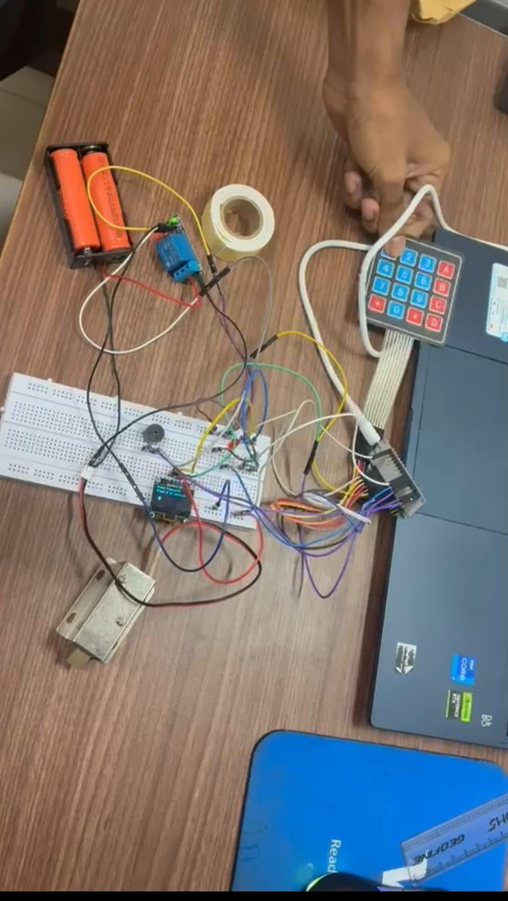
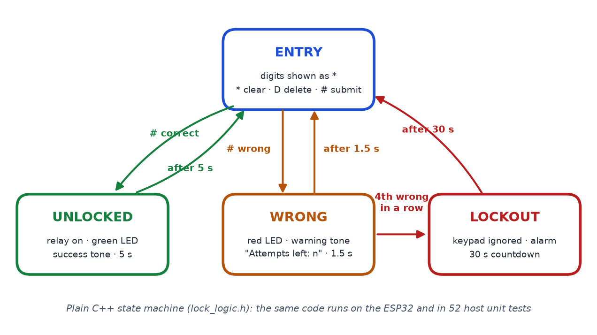

# Microcontroller-Based Digital Door Lock with Security Alert

**An ESP32 keypad lock that fights back: four wrong codes and the keypad locks itself for 30 seconds, with an alarm and a countdown.**
Its lock logic is plain C++, so the exact code that runs on the board also passes 52 unit tests on a PC.


<p align="center">
  
  &nbsp;
  
</p>
<p align="center"><em>The working prototype (ESP32, 4×4 keypad, OLED, relay, 12 V solenoid) and the state machine it runs.</em></p>

## What it does

Type a code on the 4×4 keypad.

- **Correct code:** a relay energises the 12 V solenoid for 5 seconds, the green LED lights and a success tone plays.
- **Wrong code:** the red LED lights, a warning tone sounds and the OLED shows how many attempts are left.
- **Four wrong codes in a row:** the keypad shuts out *all* input, including the correct code, for 30 seconds while an alarm sounds and the display counts down.

## Engineering details that matter

- **Testable by design.** The state machine ([`lock_logic.h`](firmware/door_lock/lock_logic.h)) makes no Arduino calls, so it compiles on a PC and is unit-tested there. The tests cover unlock and relock timing, attempts left, the lockout (the correct code is ignored during it), counter reset after success, `*`/`D`/length limits, and prefix or extended codes being rejected.
- **Constant-time code check.** The comparison checks every character even after a mismatch, so the time it takes doesn't reveal how many digits were right.
- **Survives the `millis()` wrap-around.** Timers use unsigned differences, so the lock keeps working after 49 days of uptime. This is tested.
- **Never blocks.** The keypad is polled every 10 ms (~100 Hz), and buzzer tone patterns play without `delay()`, so the keypad and display stay responsive.

## Results

| Check | Result |
|---|---|
| Bench test (report) | Correct code opened the solenoid for 5 s with "Access Granted"; wrong codes gave the red LED and warning tone; 4 failures disabled the keypad for 30 s |
| Host unit tests (`make test`) | **52 checks, 0 failures** |
| Firmware build (arduino-esp32 3.3.12) | Clean build: 320,351 B flash (24 %), 24,208 B RAM (7 %) |
| Verification latency | Printed over Serial on every `#` (`verify: N us`); report target < 50 ms |

## Hardware

| Part | Notes |
|---|---|
| ESP32 DevKit (ESP32-WROOM-32) | 3.3 V logic |
| 4×4 membrane keypad | rows and columns on 8 GPIOs |
| 0.96" SSD1306 OLED, 128×64, I²C | address 0x3C |
| 1-channel 5 V relay module | switches the solenoid supply |
| 12 V solenoid lock | separate 12 V supply through the relay's COM/NO |
| Green and red LEDs + 220 Ω, buzzer | status and alarm |

Pin-by-pin wiring is in [docs/HOW_TO_RUN.md](docs/HOW_TO_RUN.md#wiring).

| Key | Action |
|---|---|
| `0`–`9` | Add a digit (shown as `*`, up to 8) |
| `#` | Submit |
| `*` | Clear |
| `D` | Delete last digit |

| Setting (`config.h`) | Value |
|---|---|
| `MAX_FAILED_ATTEMPTS` | 4 |
| `LOCKOUT_MS` / `UNLOCK_MS` | 30000 / 5000 |
| `SCAN_PERIOD_MS` | 10 |
| `LOCK_PASSWORD` | `"2580"`: change before use |

## Repository layout

```
firmware/door_lock/   door_lock.ino (main loop, OLED screens), lock_logic.h (state machine),
                      buzzer.h (non-blocking tones), config.h (pins, password, timings)
test/                 test_lock_logic.cpp (host unit tests)
diagram.json, wokwi.toml, libraries.txt   Wokwi simulation of the same circuit
docs/                 HOW_TO_RUN.md, images/, make_state_diagram.py
report/               submitted report (PDF)
Makefile              make test / make compile / make upload
```

## Building and flashing

Unit tests, arduino-cli set-up, flashing, the Wokwi simulation and wiring: see **[docs/HOW_TO_RUN.md](docs/HOW_TO_RUN.md)**.

## Report

[`report/Digital_Door_Lock_Report.pdf`](report/Digital_Door_Lock_Report.pdf): the submitted report.

## Team

BECE204L Microprocessors and Microcontrollers, VIT Vellore, Winter Semester 2025–26.

| Name | Reg. No. |
|---|---|
| Arrnav Trisal | 24BVD0064 |
| Tarun Satish | 24BEC0631 |

## License

Released under the [MIT License](LICENSE).
