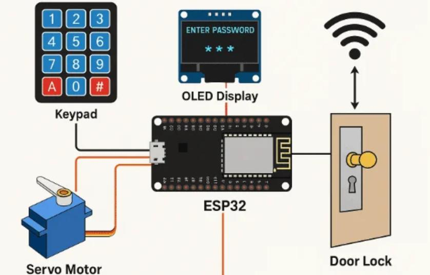

# Microcontroller-Based Digital Door Lock with Security Alert

BECE204L Microprocessors and Microcontrollers project, Winter Semester 2025-26. Team: Arrnav Trisal (24BVD0064), Tarun Satish (24BEC0631).

An ESP32 keypad lock. You type a password on a 4x4 keypad. If it is correct, a relay energises a 12 V solenoid lock for 5 seconds, the green LED lights and a success tone plays. A wrong password lights the red LED, sounds a warning tone and shows the attempts left on the OLED. Four wrong passwords in a row lock the keypad for 30 seconds, with a countdown on the display.

The submitted report is in [`report/Digital_Door_Lock_Report.pdf`](report/Digital_Door_Lock_Report.pdf).

| System | Prototype |
|---|---|
|  |  |

## Hardware

| Part | Notes |
|---|---|
| ESP32 DevKit (ESP32-WROOM-32) | 3.3 V logic |
| 4x4 membrane keypad | rows/cols on 8 GPIOs |
| 0.96" SSD1306 OLED, 128x64, I2C | address 0x3C |
| 1-channel 5 V relay module | switches the solenoid supply |
| 12 V solenoid lock | separate 12 V supply through the relay's COM/NO |
| Green and red LEDs + 220 Ω | access granted / denied |
| Active or passive buzzer | driven with `tone()` |

### Wiring

| ESP32 GPIO | Connects to |
|---|---|
| 13, 12, 14, 27 | Keypad R1-R4 |
| 26, 25, 33, 32 | Keypad C1-C4 |
| 21 (SDA), 22 (SCL) | OLED SDA, SCL (VCC 3V3, GND) |
| 4 | Relay IN (relay VCC 5V, GND) |
| 18 | Green LED through 220 Ω |
| 19 | Red LED through 220 Ω |
| 23 | Buzzer + |

The relay's COM and NO switch the 12 V line to the solenoid. Put a flyback diode across the solenoid. `RELAY_ON` in `config.h` is `HIGH`; set it to `LOW` for active-low relay boards.

## How it works

| Key | Action |
|---|---|
| `0`-`9` | Add a digit (shown as `*`, up to 8) |
| `#` | Submit |
| `*` | Clear |
| `D` | Delete last digit |

```
ENTRY ──# correct──▶ UNLOCKED (relay on, green LED, 5 s countdown) ──▶ ENTRY
  │
  └──# wrong──▶ WRONG (red LED, "Attempts left: n", 1.5 s) ──▶ ENTRY
         └── 4th wrong in a row ──▶ LOCKOUT (keypad ignored, 30 s countdown, alarm) ──▶ ENTRY
```

The state machine is in [`firmware/door_lock/lock_logic.h`](firmware/door_lock/lock_logic.h). It is plain C++ with no Arduino calls, so the exact code that runs on the ESP32 is also unit-tested on a PC. The password comparison checks every character even after a mismatch, so its timing doesn't reveal how many digits were right. Timers use unsigned `millis()` differences, so they survive the 49-day wrap-around. The keypad is polled every 10 ms (~100 Hz). The buzzer plays its tone patterns without blocking, so the keypad and display stay responsive.

| Setting (`config.h`) | Value | Report |
|---|---|---|
| `MAX_FAILED_ATTEMPTS` | 4 | 4 attempts |
| `LOCKOUT_MS` | 30000 | 30 s |
| `UNLOCK_MS` | 5000 | 5 s |
| `SCAN_PERIOD_MS` | 10 | ~100 Hz polling |
| `LOCK_PASSWORD` | `"2580"` | change before use |

## Build and test

```bash
cd ~/Downloads/doorLockProj

# Host unit tests of the lock logic (g++ only)
make test

# Firmware: ESP32 core + libraries, once
arduino-cli config add board_manager.additional_urls https://espressif.github.io/arduino-esp32/package_esp32_index.json
arduino-cli core update-index && arduino-cli core install esp32:esp32
arduino-cli lib install Keypad "Adafruit SSD1306" "Adafruit GFX Library"

make compile                      # -> build/door_lock.ino.bin, .merged.bin, .elf
make upload PORT=/dev/ttyUSB0     # flash; open Serial Monitor at 115200 baud
```

Or open `firmware/door_lock/door_lock.ino` in the Arduino IDE, select **ESP32 Dev Module** and upload.

### Simulate in Wokwi

`diagram.json` wires the same circuit in [Wokwi](https://wokwi.com). A blue LED on the relay output stands in for the solenoid. With the Wokwi VS Code extension, run `make compile`, then **Wokwi: Start Simulator** (it reads `wokwi.toml`). On wokwi.com, create an ESP32 project, paste the sketch files, `diagram.json` and `libraries.txt`.

## Results

From the report's bench tests: the correct password opened the solenoid for 5 s and showed "Access Granted" with the success tone. Wrong passwords showed an error with the red LED and warning tone. After four wrong passwords the keypad was disabled for 30 s with a countdown.

Rebuild checks:

- `make test`: 52 checks, 0 failures. They cover the 5 s unlock and relock, attempts left, the 4-failure 30 s lockout (the correct password is ignored during it), the failure count resetting after a success, `*`/`D`/length limit, prefix and extension passwords being rejected, and `millis()` wrap-around.
- `make compile` (arduino-esp32 3.3.12, ESP32 Dev Module): builds cleanly. The sketch uses 320,351 bytes (24 %) of flash and 24,208 bytes (7 %) of RAM.
- On the board, every `#` prints the measured verification time over Serial (`verify: N us`). The report's target is under 50 ms.

## Layout

```
firmware/door_lock/   door_lock.ino (main loop, OLED screens), lock_logic.h (state machine),
                      buzzer.h (non-blocking tones), config.h (pins, password, timings)
test/                 test_lock_logic.cpp (host unit tests)
diagram.json, wokwi.toml, libraries.txt   Wokwi simulation
docs/images/          system overview and prototype photo from the report
report/               submitted report (PDF)
```
